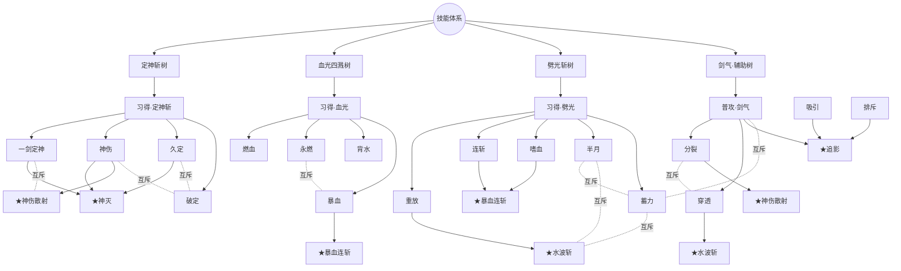
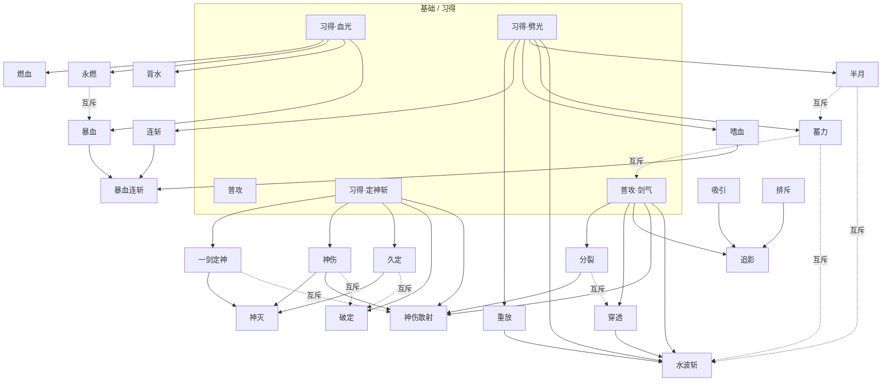

# 破天肉鸽 · 技能体系策划案

> 从实装配表提取：`data/skills.json`、`data/skill_enhances.json`、`data/upgrades.json`  
> 日期：2026-08-11  
> 交互树状图：[skill-tree.canvas.tsx](C:/Users/user/.cursor/projects/c-Users-user-Desktop-potato-bros-h5/canvases/skill-tree.canvas.tsx)  
> 关系 DAG：[skill-relation-map.canvas.tsx](C:/Users/user/.cursor/projects/c-Users-user-Desktop-potato-bros-h5/canvases/skill-relation-map.canvas.tsx)

---

## 1. 总览

| 层 | 说明 | 配置 |
|----|------|------|
| 基础技能 | 自动释放；需升级「习得」解锁（普攻除外） | `skills.json` |
| 技能强化 | 三选一词条，改参数 / 改形态 | `upgrades` + `skill_enhances` |
| 红词条合成 | 多前置齐备后出现；常停用原技能或改写结算 | rarity=2 |

**关系类型**

| 类型 | 含义 |
|------|------|
| 习得 | `unlockSkill` → 技能栏出现该技能 |
| 前置 | `requireUid` / `requireUids`（AND）已选后才进池 |
| 互斥 | `conflictUids`：选中后双方不再出现 |
| 停用 / 转化 | 合成后原技能栏显示「已转化」，逻辑改走弹道等 |

**首抽池 `firstPick`**：习得·定神斩 / 血光 / 劈光、普攻·剑气。

---

## 1.1 技能树状图

> 可交互图：[skill-tree.canvas.tsx](C:/Users/user/.cursor/projects/c-Users-user-Desktop-potato-bros-h5/canvases/skill-tree.canvas.tsx)（聊天旁打开）

---

## 2. 基础技能一览

| id | 名称 | 类型 | CD | 前摇 | 核心效果 | 优先级 |
|----|------|------|-----|------|----------|--------|
| `basic_melee` | 普攻 | melee | 由攻速 | 0 | 扇形近战；可被剑气/蓄力改写 | −100（不自动当技能放） |
| `ding_shen_zhan` | 定神斩 | rect_slash | 7s | 1.35s | 150% 伤 + 面前 3×5 定身 2.5s | 30 |
| `xue_guang` | 血光四溅 | self_buff | 10s | 0.5s | +30% 伤害率，持续 5s | 20 |
| `pi_guang_zhan` | 劈光斩 | circle_slash | 5s | 1.3s | 100% 伤，半径 ×1.5 | 10 |

定神斩前摇：蓝框**跟人走**，朝向锁起手方向；满格按当前框结算。

---

## 3. 技能树明细

### 3.1 定神斩（习得 uid 34）

| uid | 名称 | 效果 | 前置 | 互斥 |
|-----|------|------|------|------|
| 25 | 一剑定神 | 倍率 ×1.5，范围 ×2 | 34 | **42** 神伤散射 |
| 26 | 神伤 | 定身怪每秒 攻×50% | 34 | 28 破定 |
| 27 | 久定 | 定身 5s | 34 | 28 破定 |
| 28 | 破定 | 不定身，伤害翻倍 | 34 | 26、27 |
| 37 | **神灭**（红） | 宽 ×2；定身 DOT 再 +攻×50%/s | **25+26+27** | — |

### 3.2 血光四溅（习得 uid 35）

| uid | 名称 | 效果 | 前置 | 互斥 |
|-----|------|------|------|------|
| 21 | 燃血重生 | 伤额 +20%；每秒 −当前6% / +已损4% | 35 | — |
| 22 | 永燃 | 加成仅 60% 生效、治疗 ×0.5，Buff 本关无限 | 35 | **24** |
| 23 | 背水一战 | 每损 10% 生命，伤额 +5% | 35 | — |
| 24 | 暴血 | 耗当前 50% 生命，伤额翻倍 | 35 | **22** |

### 3.3 劈光斩（习得 uid 36）

| uid | 名称 | 效果 | 前置 | 互斥 |
|-----|------|------|------|------|
| 29 | 重放 | 再放一段（共 2） | 36 | — |
| 30 | 连斩 | 命中 30% 再斩 | 36 | — |
| 31 | 嗜血 | 每命中 +3 生命 | 36 | — |
| 32 | 半月斩 | 面前 180°，距离 ×3 | 36 | **38、43** |
| 38 | 蓄力一击 | 取消普攻；站立蓄力最高 ×2 | 36 | **32、39、43** |
| 33 | **暴血连斩**（红） | 血光期间连斩 100%，每次 −50 血至 &lt;10% | **24+30+31** | — |

### 3.4 普攻·剑气（uid 39，`firstPick`）

| uid | 名称 | 效果 | 前置 | 互斥 |
|-----|------|------|------|------|
| 39 | 普攻·剑气 | 普攻改弹道；溅射 | — | **38** 蓄力 |
| 40 | 剑气·分裂 | 命中裂 3 小剑气（各 50%） | 39 | **41** |
| 41 | 剑气·穿透 | 命中不消失至出视野 | 39 | **40** |
| 44 | 吸引 | 拾取范围 ×1.3 | — | — |
| 45 | 排斥 | 受伤弹开距离 ×1.5 | — | — |
| 46 | **剑气·追影**（红） | ±30° 夹角追踪 | **44+45+39** | — |

### 3.5 跨树红合成

| uid | 名称 | 前置（AND） | 效果 | 互斥 |
|-----|------|-------------|------|------|
| 42 | **神伤散射** | 39+40+34+26 | **定神斩停用**；分裂剑气定身 + 神伤 DOT | **25** |
| 43 | **水波斩** | 39+41+36+29 | **劈光斩停用**；剑气命中触发劈光·再斩（吃嗜血/连斩等） | **32、38** |

合成齐备后：抽取权重 ×`comboReadyWeightMul`（默认 8），且三选一保底至少一张合成词条。

---

## 4. 关系总图（Mermaid）

---

## 5. Build 方向（策划参考）

| 方向 | 核心路径 | 风格 |
|------|----------|------|
| 控场削血 | 定神 → 一剑 + 神伤/久定 → 神灭 | 控场 + DOT |
| 神伤散射 | 剑气 + 分裂 + 定神 + 神伤 → 散射 | 弹道控场，定神栏转化 |
| 破定爆发 | 定神 + 破定 ± 一剑 | 大范围硬伤 |
| 燃血续航 | 血光 + 燃血 ± 永燃 | 以血换伤 |
| 暴血清场 | 暴血 + 连斩 + 嗜血 → 暴血连斩 | 高风险爆发 |
| 水波穿透 | 剑气 + 穿透 + 劈光 + 重放 → 水波 | 弹道触发范围斩 |
| 追影辅助 | 剑气 + 吸引 + 排斥 → 追影 | 弹道纠偏 |
| 蓄力单体 | 劈光·蓄力（不可与剑气同持） | 站桩爆发 |

---

## 6. 互斥速查

| A | B | 说明 |
|---|---|------|
| 一剑定神 25 | 神伤散射 42 | 正确互斥对 |
| 神伤 26 / 久定 27 | 破定 28 | 定身系 vs 破定 |
| 永燃 22 | 暴血 24 | 血光两条极端 |
| 分裂 40 | 穿透 41 | 剑气分支二选一 |
| 半月 32 / 蓄力 38 | 水波斩 43 | 形态冲突 |
| 蓄力 38 | 剑气 39 | 普攻改写冲突 |

---

## 7. 配置索引

| 内容 | 文件 |
|------|------|
| 技能基础参数 | `data/skills.json` |
| 强化数值 | `data/skill_enhances.json` |
| 词条 uid / 前置 / 互斥 | `data/upgrades.json` |
| 总案其它系统 | `破天肉鸽_H5策划案.md` |
